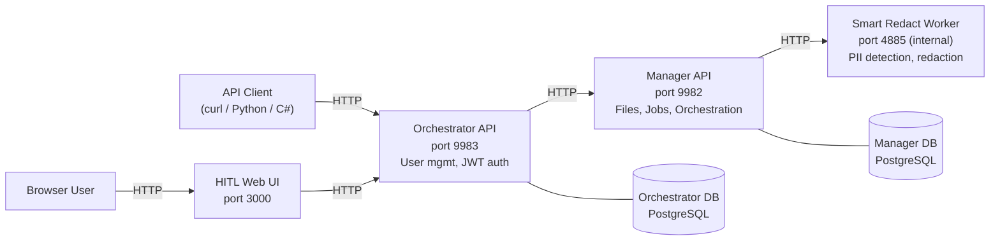

# Pdftools Smart Suite samples

Sample configurations and examples for deploying and using Smart Suite by Pdftools.

Smart Suite runs the Pdftools Smart products behind one shared Manager and Orchestrator. These samples cover [Smart Redact](https://www.pdf-tools.com/docs/smart-redact), which automatically detects and redacts personally identifiable information (PII) in PDF documents using pattern matching, keyword detection, and ML-based named entity recognition (GLiNER).

## Architecture

The samples run four Smart Suite services:



| Service                 | Port | Description                                                                 |
| ----------------------- | ---- | --------------------------------------------------------------------------- |
| **HITL Web UI**         | 3000 | Human-in-the-loop review interface for detection results and redaction jobs |
| **Orchestrator**        | 9983 | Web UI backend with user management and JWT authentication                  |
| **Manager**             | 9982 | Client-facing API for file uploads and detection/redaction jobs             |
| **Smart Redact Worker** | 4885 | Internal service that performs PII detection and redaction                  |

> For detailed architecture documentation, refer to [Smart Redact Architecture](https://www.pdf-tools.com/docs/smart-redact/references/architecture/).

## Prerequisites

- [Docker](https://docs.docker.com/get-docker/) and [Docker Compose](https://docs.docker.com/compose/install/) v2+
- A valid Smart Suite license key (legacy Smart Redact keys also work). Register at [portal.pdf-tools.com](https://portal.pdf-tools.com/) for a free trial key, or see the [licensing docs](https://www.pdf-tools.com/docs/licenses/products/smart-redact-license/) for production keys.
- For GPU acceleration: NVIDIA GPU with [NVIDIA Container Toolkit](https://docs.nvidia.com/datacenter/cloud-native/container-toolkit/install-guide.html)

## Windows users

The startup flow and API examples use bash. On Windows, use one of:

- **WSL2** (recommended). Gives you a full Linux environment, and Docker Desktop integrates with it natively, so `docker` commands just work.
- **Git Bash.** Ships with [Git for Windows](https://git-scm.com/download/win) and runs every Docker-based script in this repo, as long as Docker Desktop is running and `python3` is on your `PATH` (the curl API examples need it).

The repository also includes a standalone PowerShell key-generation helper for manual key generation; `smart-suite.sh setup` generates keys automatically.

## Quick start

The fastest way to get Smart Suite running:

**Prerequisites:** A valid Smart Suite license key (legacy Smart Redact keys also work). Register at [portal.pdf-tools.com](https://portal.pdf-tools.com/) for a free trial key, or see the [licensing docs](https://www.pdf-tools.com/docs/licenses/products/smart-redact-license/) for production keys.

```bash
# 1. Clone this repository
git clone https://github.com/pdf-tools/smart-suite-samples.git
cd smart-suite-samples

# 2. Create your .env file with generated secrets
./smart-suite.sh setup --license-key "<your-license-key>"

# 3. Start all services and wait for Docker health checks
./smart-suite.sh up

# 4. Show Compose-managed service status
./smart-suite.sh health

# Optional: stream logs
./smart-suite.sh logs
```

Once running:

- **HITL Web UI:** http://localhost:3000
- **Manager API (Swagger):** http://localhost:9982/swagger
- **Orchestrator API (Swagger):** http://localhost:9983/swagger

### Default login

Log in to the HITL Web UI (http://localhost:3000) or the Orchestrator Swagger UI (http://localhost:9983/swagger) with the built-in admin account:

| Field        | Value              |
| ------------ | ------------------ |
| **Email**    | `admin@example.com`  |
| **Password** | `Admin@1234!Tmp`     |

> These credentials are for local evaluation only. After you sign in, the Orchestrator shows a notification suggesting you change the password, but the default password keeps working until you do. Change these credentials for any shared or production deployment.

## Repository structure

```
smart-suite-samples/
├── samples/                 # Sample documents for testing
│
├── docker-compose/          # Docker Compose deployments
│   ├── cpu/                 #   Full stack (CPU inference)
│   ├── gpu/                 #   Full stack (GPU inference, NVIDIA CUDA)
│   └── minimal/             #   Manager + Worker only (no Orchestrator)
│
├── docker-run/              # Individual docker run scripts
│
├── api-examples/            # API usage examples
│   ├── curl/                #   Shell scripts (step-by-step)
│   ├── python/              #   Python examples
│   └── csharp/              #   C# / .NET example
│
└── scripts/                 # Utility scripts
```

## Deployment options

| Option                                              | Best For                             | Guide                             |
| --------------------------------------------------- | ------------------------------------ | --------------------------------- |
| [Docker Compose (CPU)](docker-compose/cpu/)         | Quick start, development, evaluation | [Guide](docker-compose/README.md) |
| [Docker Compose (GPU)](docker-compose/gpu/)         | Production with GPU acceleration     | [Guide](docker-compose/README.md) |
| [Docker Compose (Minimal)](docker-compose/minimal/) | API-only usage without Orchestrator  | [Guide](docker-compose/README.md) |
| [Docker Run](docker-run/)                           | Manual control over each container   | [Guide](docker-run/README.md)     |

## API examples

For complete usage examples, refer to [api-examples/](api-examples/), which covers:

- Uploading PDF files
- Running PII detection
- Downloading detection results
- Running PII redaction
- End-to-end workflows

> For the full API reference, refer to [Smart Redact API Documentation](https://www.pdf-tools.com/docs/smart-redact/references/api/).

## Configuration reference

Configure all Smart Suite services through environment variables:

| Variable                  | Required | Description                                                                                    |
| ------------------------- | -------- | ---------------------------------------------------------------------------------------------- |
| `PDFTOOLS_LICENSE_KEY`    | Yes      | Smart Suite license key (legacy Smart Redact keys also work)                                   |
| `ENCRYPTION_KEY`          | Yes      | 32-byte Base64-encoded AES-256-GCM key                                                         |
| `ORCHESTRATOR_JWT_SECRET` | Yes\*    | JWT signing secret (min 32 chars). \*Only for Orchestrator.                                    |
| `VERSION`                 | No       | Docker image tag (default: `latest`). Smart Suite images are available from `1.0.0`.           |
| `HITL_WEB_PORT`           | No       | Host port for the HITL Web UI (default: `3000`)                                                |
| `HITL_ORCHESTRATOR_URL`   | No       | Browser-facing Orchestrator API URL used by the HITL Web UI (default: `http://localhost:9983`) |

> For all configuration options, refer to [Smart Redact Configuration Guide](https://www.pdf-tools.com/docs/smart-redact/guides/configuration/).

## Security notes

The Docker Compose files and `docker-run/` scripts in this repository hardcode default credentials for local demonstration only:

| Service    | User         | Password     |
| ---------- | ------------ | ------------ |
| PostgreSQL | `smartsuite` | `smartsuite` |
| RabbitMQ   | `guest`      | `guest`      |

For any non-local deployment, replace these with strong values.

## Documentation

- [Smart Redact Documentation](https://www.pdf-tools.com/docs/smart-redact)
- [Configuration Guide](https://www.pdf-tools.com/docs/smart-redact/guides/configuration/)
- [API Reference](https://www.pdf-tools.com/docs/smart-redact/references/api/)
- [Architecture](https://www.pdf-tools.com/docs/smart-redact/references/architecture/)
- [Licensing](https://www.pdf-tools.com/docs/licenses/products/smart-redact-license/)

## License

This repository contains sample configurations for Smart Suite, a commercial product by [PDF Tools AG](https://www.pdf-tools.com). Running the service requires a valid license key.
