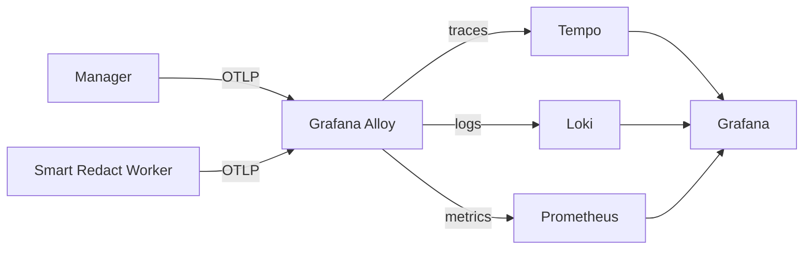

# Observability

The cpu, gpu, and minimal Docker Compose variants start Alloy, Tempo, Loki, Prometheus, and Grafana. The Manager and
Worker export traces, logs, and metrics over OTLP, and Grafana displays all three.

| Tool | URL | Purpose |
|------|-----|---------|
| Grafana | http://localhost:3001 | Dashboards (opens on "Smart Suite - Overview") |
| Prometheus | http://localhost:9090 | Metrics store and query UI |



Every variant includes the stack from `infra/observability.compose.yml`, and sets the OTLP settings on the Manager
and Worker. Set `GRAFANA_PORT` or `PROMETHEUS_PORT` in `.env` to change the host ports.

Grafana and Prometheus listen on `127.0.0.1` only. Grafana accepts anonymous visitors, gives them the Viewer role,
and lets them use Explore for traces and logs.

## Dashboard

The "Smart Suite - Overview" dashboard (`infra/dashboards/smart-suite-overview.json`)
groups panels into:

| Panel group | Description |
|-------------|-------------|
| **Jobs Overview** | Total jobs, detection vs redaction, errors, jobs over time |
| **Detection Metrics** | Entities detected, pages processed, entity type distribution |
| **Licensing** | Pages consumed per Smart Product, failed consumption reports |
| **HTTP Server** | Request rate by route, p95 latency, 5xx errors |
| **Operation Results** | Recent job spans with IDs, page counts, file sizes, entity counts, trace links |

The Manager and Worker export metrics every 15 seconds (`OTEL_METRIC_EXPORT_INTERVAL`), so new jobs
appear on the dashboard within 15 seconds.

## Metrics

The table lists the custom counters by their Prometheus names. Job counters have the labels `job_type`
(`detection`/`redaction`) and `job_status` (`Finished`/`Error`). Licensing counters
have the label `license_product` (`smart_redact`, `smart_extract`).

| Metric | Extra labels | Description |
|--------|--------------|-------------|
| `jobs_completed_total` | (none) | Jobs completed |
| `detection_entities_detected_total` | `entity_type` | Entities detected, by label |
| `detection_pages_processed_total` | (none) | Pages processed by detection jobs |
| `licensing_pages_consumed_total` | `license_product` | Pages counted against your license |
| `licensing_consumption_reports_failed_total` | `license_product` | Failed consumption reports (retried) |

The Manager and Worker export the standard OpenTelemetry HTTP server metrics (`http_server_request_duration_seconds_*`)
and metrics for the MassTransit message bus.

## Traces

The Worker records one span for each detection and redaction job and sets the attributes
`job.id`, `job.type`, `job.status`, `job.file.id`, and job-specific counts on the span. Open the spans
in Grafana under **Explore → Tempo**. Useful TraceQL queries:

```
{span.job.id = "your-job-id-here"}
{span.job.status = "Error"}
{span.job.status = "Error" && span.job.type = "detection"}
```

## Logs

Alloy sends application logs to Loki over OTLP. Each log record includes `TraceId`/`SpanId`, so you can open the
matching trace. Useful LogQL queries:

```
{service_name="smart-redact-worker"} |= "DetectionResultEvent"
{service_name="smart-redact-worker"} |= "ResultEvent" | json | FileId = "your-file-id-here"
```

## Pointing at your own monitoring

To send telemetry from the Manager and Worker to your own OTLP-capable backend, change `OTEL_EXPORTER_OTLP_ENDPOINT`
(and `OTEL_EXPORTER_OTLP_PROTOCOL`, `grpc` or `http/protobuf`) on both services, then import
`infra/dashboards/smart-suite-overview.json` into your own Grafana.

> For all telemetry options, refer to the [Smart Suite Configuration Guide](https://www.pdf-tools.com/docs/smart-suite/guides/configuration/).
